# recettear-mods

Mods for *Recettear: An Item Shop's Tale* (Steam, English 1.108), built on the
[**Recettear Mod Loader**](https://github.com/Francesco149/recettear-mod-loader). This repo is a **mod source**:
`registry.json` lists the mods for the loader's launcher, which downloads them (every file sha256-pinned) into your
game folder. You need your own copy of the game; the game exe and your saves are never modified.

**Install:** [step by step in the loader's README](https://github.com/Francesco149/recettear-mod-loader#get-it-running-steam-install-2-minutes)
— get the loader's release, run `recettear-launcher.exe`, install mods from *Browse*, press *Launch game*.

**Showcase video:** [watch](https://github.com/Francesco149/recettear-mod-loader/releases/download/v0.1.0/showcase_readme.mp4)
(1 minute, every mod in the real game).

| mod | what |
|---|---|
| [`display`](#display-settings) | a Display Settings page in the game's own Options: display mode, resolution, widescreen, render scale, VSYNC, frame rate up to your display's refresh rate |
| [`free-camera`](#free-camera) | an extra camera in the shop's Button-4 cycle: turn, zoom, raise |
| [`first-person`](#first-person) | walk your shop in first person: mouse look, WASD |
| [`wardrobe`](#wardrobe) | recolour Recette by region (hair, eyes, clothes), everywhere she appears |
| [`unlock-menu`](#unlock-menu) | the full title menu whatever your saves hold |

All screenshots below are the real game at 1920×1080, taken by `tools/showcase/shots/` (the preset strip: frames of
the showcase video's capture, `tools/showcase/video/`).

## Display Settings

A page in the game's own Options menu (title and pause), drawn with the game's own panels and font. Changes apply
live.

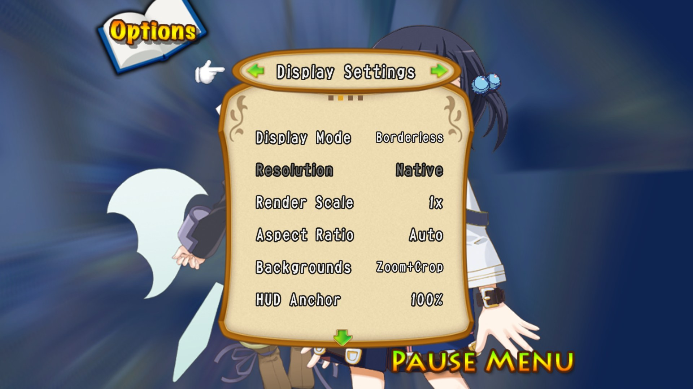

**Widescreen.** The 3D view is widened (Hor+), the HUD moves to the screen's edges, 4:3 pictures are zoomed,
pillarboxed or stretched as you choose. The game's own 4:3 picture, then 16:9:

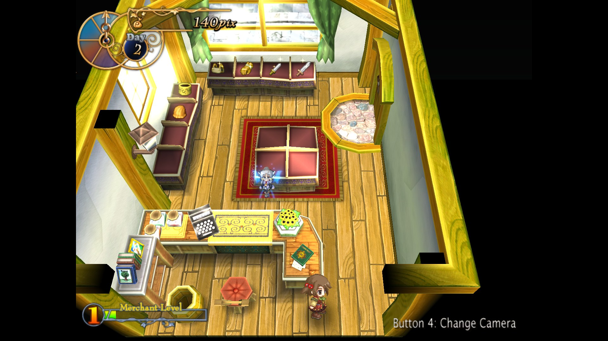
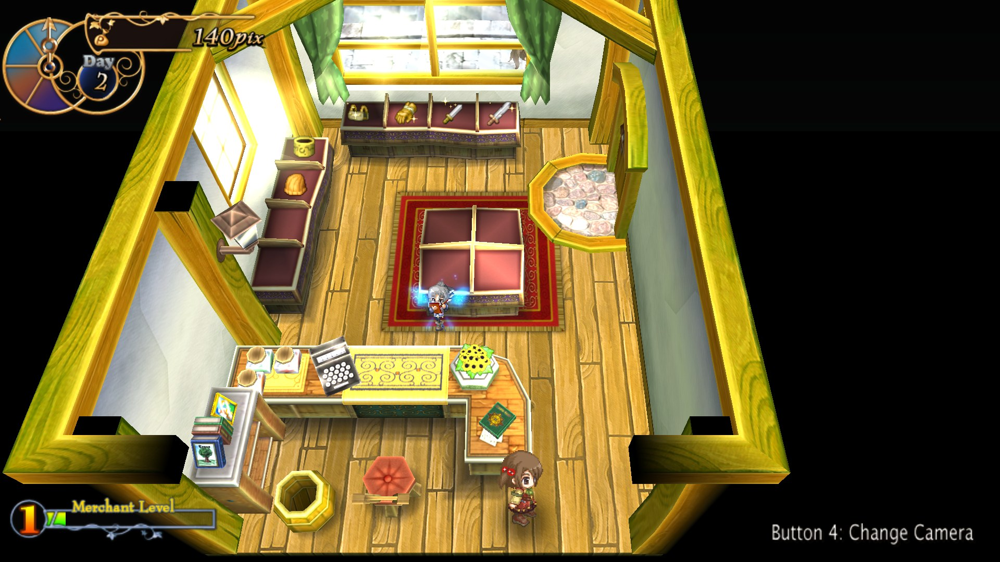

**High refresh rate.** The game simulates at 60 ticks a second; with Frame Rate on *Auto* the frames in between are
interpolated up to your display's refresh rate (144 Hz, 240 Hz, …) without changing the game's speed. *60 (stock)*
keeps the game's own pacing.

**Also:** borderless / exclusive fullscreen / windowed, any resolution, render scale (supersampling) 1–4×, VSYNC,
24-bit depth buffer.

## Free Camera

Button 4 in the shop cycles the game's two cameras; this adds a third you can turn (`[` `]` or right-drag), zoom
(PgUp / PgDn / wheel) and raise (Home / End). Walking stays camera-relative; cutscenes hand back to the game's
camera.

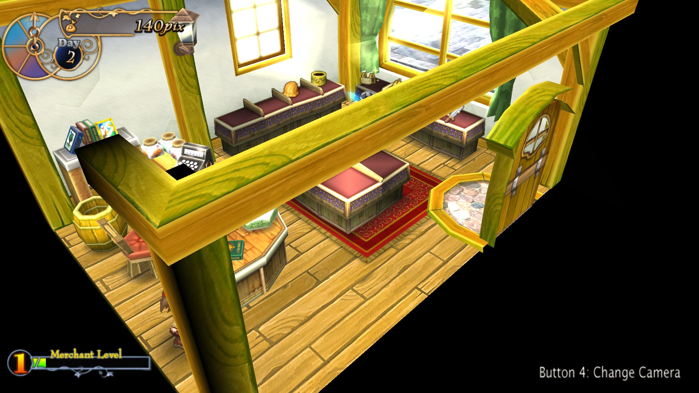
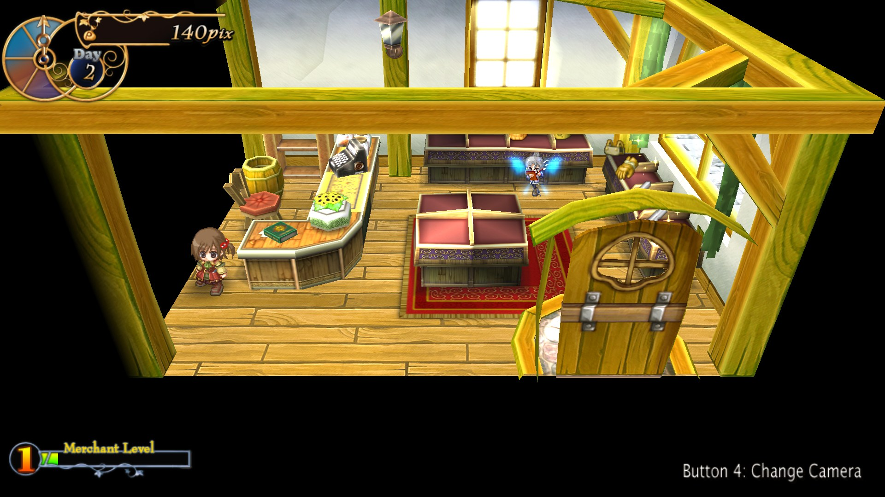

## First Person

Another camera in the same cycle, at Recette's eyes: mouse look (at your display's refresh rate), WASD, left click =
talk / confirm, right click or Tab = menu. Field of view, sensitivity and eye height are on its own Options page.

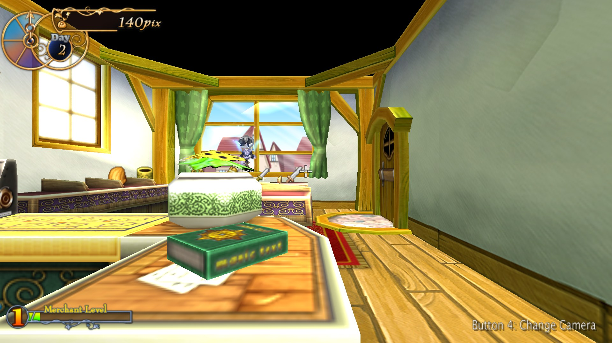
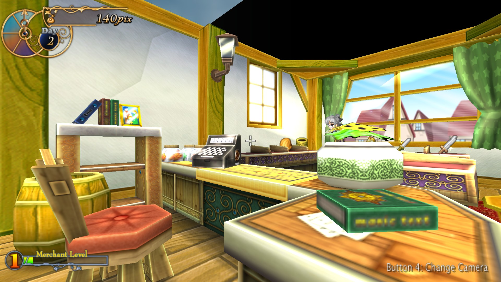
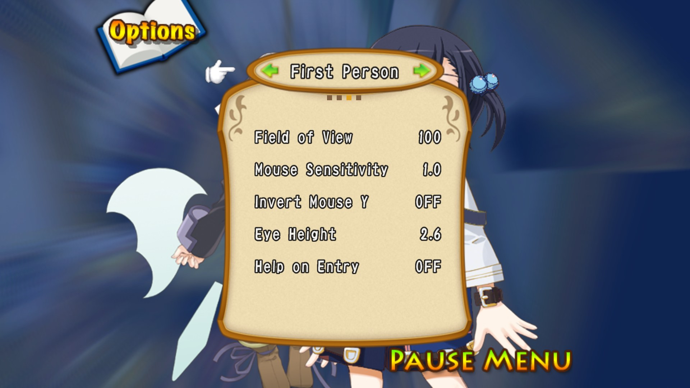

## Wardrobe

Recolour Recette's hair, eyes, skin, shirt, top, tie, apron, skirt, bobbles and boots: presets or your own colour
per region, with a live preview. The recolour keeps the artwork's shading and is applied to your own game files as
they load — nothing is written to the game folder, and no game art is in this repo (the mod ships rules, not pixels).

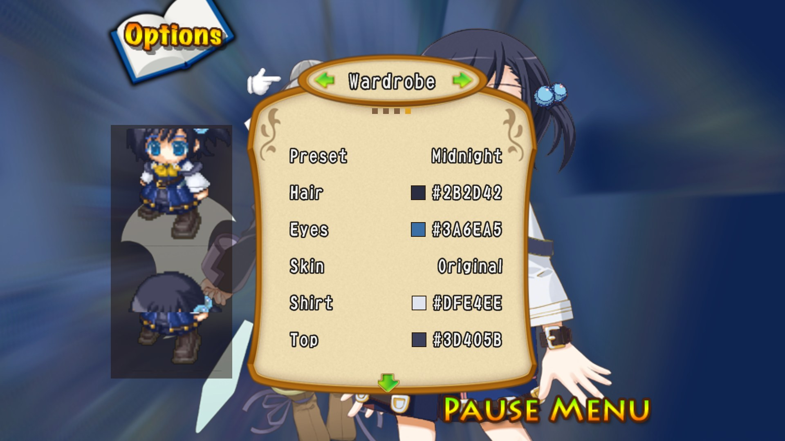

Original and the *Midnight*, *Sakura* and *Forest* presets in the shop:

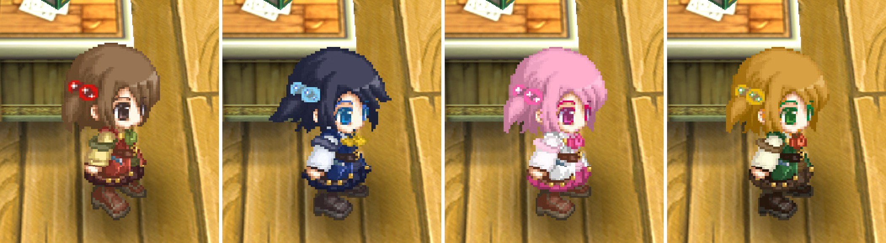
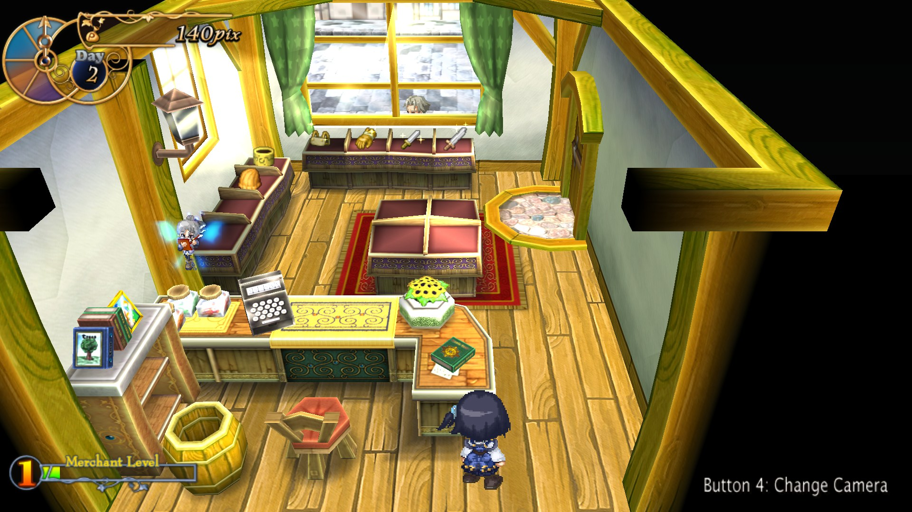

## Unlock Menu

All 8 title-menu entries from the start; New Game+ and Survival can start from any slot (an empty slot = a fresh
start). Writes nothing to `save.dat`.

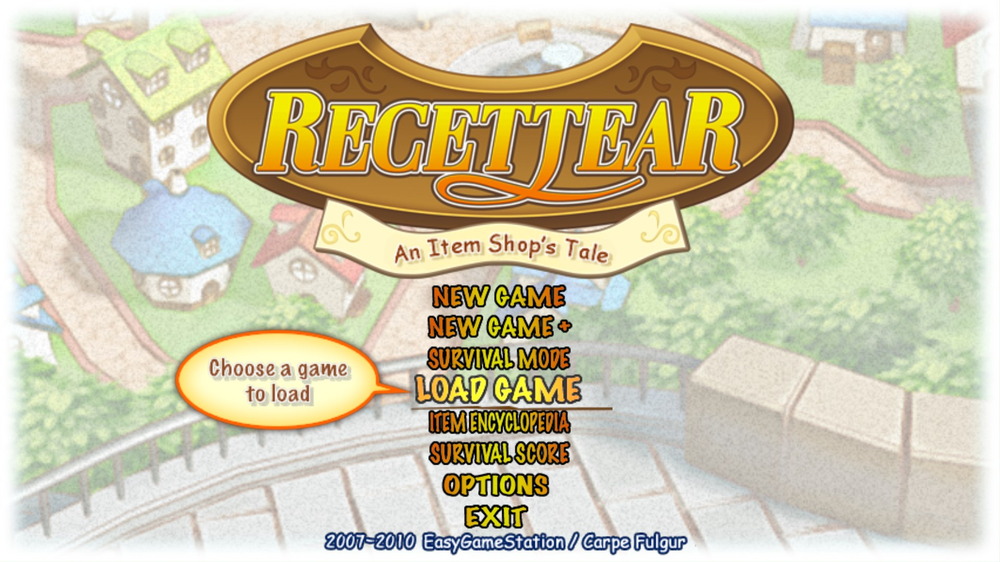

## For mod authors

Mods are Lua (LuaJIT) on the loader's API: see the loader's
[`docs/MOD-FORMAT.md`](https://github.com/Francesco149/recettear-mod-loader/blob/master/docs/MOD-FORMAT.md). Each
mod here is one small folder under [`mods/`](mods/); specs in [`docs/mods/`](docs/mods/). `registry.json` is
generated by `tools/registry/registry.py`.

## Legal

MIT (see [LICENSE](LICENSE)). No game files or anything derived from them are in this repo, apart from the
screenshots above. Mods that need game-derived data (the wardrobe's recoloured images) generate it on your machine
from your own copy.
